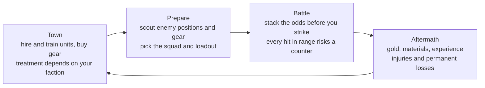

# Undercurrent: Concept

Working title: Undercurrent · darkcrux · moved from the claude.ai doc on 17 Oct 2026.
Combat details live in [combat-rules.md](combat-rules.md); the first playable target in
[vertical-slice.md](vertical-slice.md). Items marked *Proposal* are suggestions not yet confirmed.

## Pitch

**Every attack invites a counter. Good commanders decide who gets to strike back.**

A turn-based tactical RPG in the tradition of Tactics Ogre, Final Fantasy Tactics and Disgaea. Between
battles, you visit towns to hire and train a company of units and buy their gear, and each town treats
you according to your faction. In battle, every attack in range risks a counter-attack. Skills, magic,
gear, status and position shift the odds, so a well-built unit in the right spot can strike without
reply. Units can die for good, so every risk is a real one.

**World:** a grim steampunk world where magic and technology are two ways of drawing on the same
elemental source. **Story:** you play one main character who awakens as one of the Unbound and fights
on the field, joined by a few unique comrades. Your origin decides how the story opens, and the
choices you make over the first chapters decide which side you end up on. The factions stand on the
brink of war.

## Design pillars

1. **Every strike has an answer.** Every attack in range can draw a counter. Gear, skills and position
   change who strikes back.
2. **One source, three paths.** Magic, tech and the Unbound draw on the same power, and every faction
   pays a price for it.
3. **A company worth keeping.** Hire, train and equip a company of your own. Losses can be permanent,
   so every risk is real.

The goal behind all three: fights are won by reading the field, not by stats. The foundation: an
attack preview that shows counter odds before you commit. When a feature idea comes up, keep it only
if it serves at least one pillar.

## Core loop

One mission runs the full loop. Battle is the heart, and what you buy and train in towns changes how
the next battle plays.

## World and factions

A grim steampunk world. Beneath everything runs **the Current**: one elemental energy that shows up as
fire, lightning, frost and the rest. Everyone in the game is human, and everyone who wields the
elements draws on the Current. What divides them is how they reach it.

| | The Ordained (magic) | The Commonwealth (tech) | The Unbound |
| --- | --- | --- | --- |
| Reach the Current through | Words, gestures, rituals, sigils | Steam-age machines built around Current cells | Their own bodies, no tool needed |
| Goal | Rule over everyone who can't use magic | World domination through industry and arms | Split (see Unbound goals) |
| Gift to the world | Healing and protection: medicine, wards that shield cities, no smoke or waste (proposal) | Ease of life: light, heat, transport and power for ordinary people | Harms the world least: draws only what one body can hold, with no machines or rituals multiplying it (proposal) |
| Cost to the world | Drains the Current faster than it renews | Environmental destruction: smog, poisoned rivers, dead land | Costs the user instead: it burns out the body, and it can't be taught or shared, so it can't lift a whole society (proposal) |
| In battle | Flexible effects: wards, curses, illusions | Reliable, mass-produced power: firearms, armor plating, gadgets | Instant and silent; strains the body |
| Counter style | Wards block counters; curses weaken the enemy's counters | Armor and gear raise counter chance; ranged weapons strike from outside counter range | Hidden status and fast reflexes: strike without reply, or counter harder |
| Weakness | Slow to cast, years to learn, few practitioners | Devices can break, jam or be sabotaged; heavy gear slows units | Rare; overuse burns them out |

**The pattern:** tech costs the land, magic costs the Current, and the Unbound cost themselves. Every
faction pays for its power; the story is about who pays and who decides.

**The tension.** The Ordained are a ruling elite of mages over everyone else. The Commonwealth's
devices put elemental power in anyone's hands, which wins over people the Ordained oppress, but the
Commonwealth wants the world for itself. The Unbound threaten both: the Ordained call them heretics,
and the Commonwealth wants to study and copy them.

**On the brink of war.** The three factions are not at war yet. Borders are armed, raids and sabotage
are common, and everyone expects the war to start soon. The story opens in the last days of the peace.
*Proposal:* the shared Chapter 1 event is the spark that starts it.

### Governments

Each government grows out of how its faction reaches the Current, and each claims to be something it
isn't.

| | The Ordained | The Commonwealth | The Unbound |
| --- | --- | --- | --- |
| Form | Aristocracy and theocracy in one | Militaristic and capitalist | A scattered, wandering people, not a state |
| Claims to be | A holy order guarding a sacred gift | A commonwealth of free towns, power for everyone | The first people, the rightful heirs of the Current |
| Who rules | The great mage Houses. Their heads sit on the High Conclave, which picks a Hierarch for life | The Directorate: company heads and the general staff, who control the Lode, the money and the army. The Common Assembly of town delegates approves what it is told | Each band or refuge is led by its elders, the Keepers. Bands meet rarely, at a secret Gathering |
| How power passes | By blood. Every child is tested; common-born children with aptitude are taken into a House | By wealth, rank and contracts; anyone can rise, in theory | By age and respect; once, by strength (the Old Kings) |
| Ordinary life | Non-mages are the Lay: they tithe, serve and live under church law; only mage courts can judge a mage | Company towns, company scrip, debt contracts, conscription; machines in every home | Always moving, always hidden, protecting their children, keeping the history the others erased |
| Hardline wing | The High Conclave is the government | The Directorate is the real power | The Severed want a new Old King |
| Reform wing | The Penitents hide inside the clergy | The Common Hand: unions and old Assembly loyalists | The Menders: consensus and healing the world |

**The free towns.** Towns like Ashfield govern themselves under charters: a mayor and a merchant
council, with mercenary companies keeping order. They stay neutral under the *Border Compact* (name is
a proposal), the treaty that ended the last war between the Ordained and the Commonwealth. Both sides
have been bending it for years; in Chapter 1, it breaks.

### History of the Current

1. **The wounded being.** Long ago, something vast came to rest beneath the world and merged with it.
   The world never accepted it: the Current is its blood, an unnatural power running through a world
   that was whole without it. Where it came from is never fully explained.
2. **The Age of the Unbound.** The first humans touched by its blood became the Unbound, able to
   channel the Current with their bodies. They ruled over everyone who couldn't.
3. **The rise of magic.** The un-attuned learned to reach the Current through sigils and rituals,
   overthrew the Unbound, and became the Ordained. The Unbound were hunted and erased from history.
4. **The first dead lands.** Centuries of magic inflamed the wound where the being and the world are
   joined, and dead zones appeared like scar tissue. The Ordained abandoned those regions and the
   non-mages living there.
5. **The birth of tech.** In the dead lands, people found the Current crystallized in the rock and
   built machines to mine and burn it. Their mining towns became the Commonwealth. Mining poisons the
   land; magic drains the living flow.
6. **The present.** Every use of the Current inflames the wound, and the being is waking in pain. It is
   a victim, not a destroyer. The final chapter, where all paths meet, takes place at the wound.

Every faction has been the oppressor at some point: the Unbound once ruled, magic overthrew them and
became a ruling elite, and tech rose against magic.

**What stays a mystery:** where the being came from, what it was before, and whether it knows people
exist.

**Removing the Current resets the world.** Without it, the world heals, but everything built on the
Current ends: magic fades, machines go cold, the Unbound lose their power, and civilization starts
again from scratch. It's the end of one world and the beginning of a new one. The factions can't
accept this: magic and tech are too convenient, and the Unbound may not survive it.

### What each faction calls it

"The Current" is the common name and what the game's interface uses. Each faction has its own word and
its own partial truth:

| Faction | Their word | What they believe |
| --- | --- | --- |
| Ordained | The Grace | A sacred gift from a sleeping god to the worthy. Half right; they will never accept that they're hurting it. |
| Commonwealth | The Lode | Deposits and seams to mine. Their surveyors found strange things deep underground and buried the reports. |
| Unbound | The Old Blood | The oldest remember it as kin, or feel its pain in their veins. They know it's alive, but not what it is. |

Each path reveals a different piece, and only the shared final chapter shows the whole picture, so
replaying on other paths teaches players more.

### If nothing changes (proposal)

| Stage | What happens |
| --- | --- |
| The present | The Current still works, but the wound is inflamed: sickness near the dead lands, unstable storms of raw Current, and a constant ache the Unbound feel. Each faction blames another. |
| Dead zones spread | Scar tissue grows; nothing lives there and the Current can't be used. Could appear as battle maps where abilities cost more or fail. |
| The being wakes | Its pain tears through the world, and every faction races to the wound for its own reasons: the shared final chapter. |

### Sub-factions

Each faction has two wings: a hardline wing that embodies the faction's flaw, and a reform wing that
leans toward Accord. Players reach a faction through their choices (see Origins and paths) and start
in its hardline wing. Some choices move them to the reform wing, and later choices can move them back.
How the wings appear in the story is still open. Names are placeholders.

| Faction | Hardline wing | Reform wing (Accord) |
| --- | --- | --- |
| Commonwealth | **The Directorate**: owners and generals pushing conquest and output, whatever the land suffers | **The Common Hand**: engineers and workers who see the damage firsthand and want cleaner, safer machines |
| Ordained | **The High Conclave**: old mage families who see magic as a birthright and non-mages as servants | **The Penitents**: mages who secretly teach outsiders and come to see magic as a sin to atone for, even if it means giving it up |
| Unbound | **The Severed**: radicals who want magic and tech destroyed | **The Menders**: those who want to free the world from the Current, even if it costs them their power |

*Proposal:* each wing has a leader or one or two key characters, so wing shifts come from decisions
about people, and unique comrades can come from either wing.

### Origins and paths

The story is built like Cyberpunk 2077's lifepaths: a different opening per origin, then one shared
chapter, then the paths split.

**1. Origin prologue.** The player chooses the main character's origin. Each prologue is short and ends
the same way: the main character is revealed as Unbound and has to run.

| Origin | Who you were | The prologue |
| --- | --- | --- |
| Commonwealth | A Lode miner in a dead-lands town | A cave-in near a violet crack awakens you; Directorate soldiers come for you |
| Ordained | A novice from a minor mage house | Your power shows during a rite, and it is clearly not magic; your own house turns on you |
| Unbound | Born and raised in a hidden Unbound refuge | Hunters find the refuge, and you escape as it burns |

**2. Chapter 1, shared.** Every origin leads to Ashfield, a free town where the three factions' borders
meet (name is a proposal). The main character arrives as a fugitive and hires on with a mercenary
company to survive. A surge of raw Current erupts there, and all three factions converge on it. You
meet your first comrades here.

**3. Your faction is earned, not picked.** There is no single faction menu. Two or three key choices in
Chapter 1 decide which faction's Chapter 2 you enter. Chapters 2 and 3 each have a defection point
where you can break with your side and cross to another, at a cost: lost comrades, hostile towns, a
turncoat's reputation. The path locks at the end of Chapter 3.

| Chapter | What it is |
| --- | --- |
| Prologue | One of three origins |
| Chapter 1 | Shared, in Ashfield; your choices lean you toward a faction |
| Chapter 2 | Per faction, with a defection point |
| Chapter 3 | Per faction, with a defection point; the path locks at its end |
| Chapter 4 | The final chapter at the wound, shared by every path; the endings |

**Origin keeps mattering all game:** extra dialogue options, people who knew you, and how towns first
treat you.

### Unbound goals (decided: a split, driven by the draining)

- **Destroy magic and tech.** The radical path; it makes the Unbound as dark as the others.
- **Stop the draining.** Magic drains the Current faster than it renews, tech poisons the land, and the
  world is dying from both. The Unbound may be right, and still willing to do terrible things.
- **A split.** Some Unbound want both powers destroyed; others want to hide or coexist. The main
  character's choices could tip the balance.

### Endings

Your path and your decisions set the ending: each path has an Accord ending and a faction ending.
Neither is labeled good or bad in the game. The Accord ending ends the world as it is so a new one can
begin: grim, but the only hopeful road. A faction ending is a true victory from that faction's point of
view: it rules a scarce, ruined world on its own terms, still on the road to destruction.

| Path | Accord ending (the reset) | Faction ending (the faction rules) |
| --- | --- | --- |
| Commonwealth (tech) | With the Common Hand, the main character turns the empire's machines against the wound and removes the Current. The machines go cold, but the Common Hand's engineering knowledge survives to help the new world rebuild. | The Directorate rules one empire over a choking world. Fuel is rationed, scarcity keeps people obedient, and mages are hunted or put to work. The main character is the empire's Unbound weapon. The machines run on, and the world keeps dying. |
| Ordained (magic) | The main character reveals what they are, and the Penitents help them remove the Current. Magic fades; the Penitents keep the record of what happened so the new world never repeats it. | The High Conclave rules. Non-mages serve, machines are smashed, and magic belongs to the few, with scarcity as their tool of control. With no rival, the wound worsens faster. The main character keeps their secret forever. |
| Unbound | The Menders win. The main character channels the Current out of the world at the wound and burns out doing it. The Unbound lose their power with it, and the world starts over. | The Severed win. Machines die, mages are cut off, cities collapse into famine, and the Unbound rule the ruins, becoming the rulers they once were. They need the Current to live, so it stays, and the wound keeps spreading, only more slowly. |

**True ending (a condition, to be designed).** Reachable from any path, not a fourth path. If you have
earned the trust of all three reform wings (the Penitents, the Common Hand and the Menders) and kept
key comrades from each faction alive, the wings unite around the main character in Chapter 4 as a
faction of your own. The world still resets, so it stays bittersweet, but it is the version where the
most people survive, possibly including the main character.

**Catastrophe.** Losing the final battle shows a seventh ending instead of a plain game over: the being
wakes fully, the Current erupts from the wound, the dead lands swallow everything, and the world ends
with nothing after it. No faction wins and there is no reset. The player can then retry the battle.

**What decides the ending (proposal)**

- A handful of major choices per path, shown clearly as big moments, not hidden flags.
- How you treat the other sides: mercy or ruthlessness at key points.
- Which unique comrades survive. With perma-death, losing a comrade could push toward the faction
  ending. *Caution:* on Hard this may feel punishing; a comrade's death could change the ending
  instead of blocking the Accord one.

*Scope note:* the shared final chapter reuses one set of maps for all paths, and the six endings can be
mostly epilogue scenes rather than new battles.

### Routes

Like Tactics Ogre, the story branches at a few key decisions instead of tracking alignment points.
Every route ends in one of six sub-factions. Progress, Order, Severance and Accord stay as names for
what each wing stands for, but there are no counters.

| Faction | Hardline wing: faction ending | Reform wing: Accord ending |
| --- | --- | --- |
| Commonwealth | The Directorate (Progress) | The Common Hand (Accord) |
| Ordained | The High Conclave (Order) | The Penitents (Accord) |
| Unbound | The Severed (Severance) | The Menders (Accord) |

**The final chapter.** You arrive at the wound representing your sub-faction. The other five are still
there, but weaker, as lighter resistance. The maps stay shared; only the forces change.

*Proposal:* decision points are shown clearly as major moments, and the screen always shows which wing
you're in.

## Key mechanics

Counter-attacks are the hook; factions, a branching story and perma-death give each battle stakes.
Full rules and numbers: [combat-rules.md](combat-rules.md).

- **Counters on every attack in reach:** 75% from the front, 50% from the flank, 25% from behind, at 50%
  damage. Height, Braced, crits, Hidden, Suppressed and gear change the odds, all the way to 0% or
  100%. Out of the defender's weapon reach means no counter.
- **The attack preview** shows hit chance, damage, crit and counter odds on a hit, a crit and a miss
  before you commit.
- **Facing and vision:** facing sets both counter odds and what a unit can see, which decides whether
  Hidden enemies can be targeted.
- **Each faction plays differently:** channeling for the Ordained, deployables for the Commonwealth,
  the Blood Price for the Unbound.

### Towns, shops and guilds

There is no base. Between missions you visit towns, and each town is controlled by a faction (or by no
one). How shops, trainers and guilds treat you depends on that faction and yours.

| Your standing in the town | How you're treated (proposal) |
| --- | --- |
| Your own faction | Full stock including faction gear, fair or discounted prices, faction recruits and trainers |
| Neutral (a free town) | Standard stock and prices; mercenary guilds hire to anyone |
| Rival faction | Higher prices, limited stock, faction gear locked; some shops refuse you |
| Hostile (open war, or you've been exposed) | Most shops refuse service; staying too long can trigger an ambush battle |

*Proposals:*

- **Black markets** serve anyone at a markup, and are the only way to buy another faction's gear.
- **Your wing and past choices soften or harden treatment.** A rival's reform wing may trade with you
  in secret if you've helped them.
- **The Unbound path is the hardest here.** Almost every town is rival or hostile, so you rely on black
  markets and hidden Unbound safehouses.

What a base would have done now lives in towns:

| Need | Where you get it |
| --- | --- |
| Hiring units | Mercenary guilds and faction recruiters |
| Class changes and skills | Trainers; faction trainers teach faction skills |
| Weapons and upgrades | Smiths and shops, including gear that raises or lowers counter odds |
| Injury recovery | Rest between missions; healers shorten it for a price |
| Remembering the fallen | A roster record of fallen units and how they died |

### Units and perma-death

- Hired units come with traits and grow through classes. Unique story comrades join along the way and
  can die for good, as in Tactics Ogre: their side quests and dialogue are gone, and people who knew
  them react.
- Difficulty is chosen at the start and sets what happens when a unit falls:

| Mode | When a unit falls |
| --- | --- |
| Casual | If not revived, out of service for 1 mission per turn spent down, capped at 3 missions, then returns |
| Normal | Countdown of 3 turns to revive; if not revived, dead for good (like Tactics Ogre) |
| Hard | Dies immediately |

- *Proposal:* if the main character falls, the battle is lost, in every mode.
- *Proposal:* rescued units in Normal still carry an injury for a few missions, so losses hurt even
  when no one dies.

## Inspirations

The mix is familiar genres; what's new is counters on every attack in a world where magic and tech
share one source.

| Game | What we take |
| --- | --- |
| Tactics Ogre | Counter-attacks, terrain and height, a company of hired units, story routes, class unlock conditions |
| Final Fantasy Tactics | Class system, facing, downed-unit countdown |
| Disgaea | Deep unit growth and a hub you return to |
| XCOM | Perma-death that hurts, move-and-act turns |
| Battle Brothers | Mercenary company management and gritty losses |
| Cyberpunk 2077 | Origin prologues that lead into one shared story |

## Art direction

HD-2D: pixel-art characters standing in a lit 3D diorama. Grim and smoky, with warm light pushing back
against the dark. The battlefield is always the clearest, brightest thing on screen. Reference: the
Gemini concept image and video from 17 Oct 2026, used for mood only.

### The look

- **3D tile world** with pixel textures (nearest filtering), lit by real lights with soft shadows.
- **Pixel-art sprites** that face the camera and take the scene's light.
- **Camera:** fixed angle looking down at about 30°, the whole map visible like a miniature.
  *Proposal:* rotate in 90° steps, as in Final Fantasy Tactics.
- **Atmosphere:** tilt-shift depth of field blurring the top and bottom edges, volumetric fog, glow on
  lamps and magic, light color grading. Used with restraint: the effects frame the battlefield, never
  cover it.

### Palette

| Role | Color | Hex | Used for |
| --- | --- | --- | --- |
| Soot stone | Warm grey with a violet cast | #4A4440 | Ground, walls, most of the world |
| Deep shadow | Near-black brown | #1C1915 | Shadows, iron, outlines |
| Lamplight | Amber | #F2B45A | Lamps, furnaces, sparks, warm highlights |
| Dusk sky | Burnt orange | #D9895A | Skies, distant haze |
| Smog | Brown-grey | #6B5F55 | Fog, smoke, background layers |
| The Current | Violet | #8F6BFF | Anything drawing on the Current: cracks in the ground, spells, the glow inside tech devices |
| Unbound | Crimson | #D8283C | Unbound power: the Current passing through blood |
| Commonwealth | Brass | #C08A3E | Tech gear, gauges, pipes |
| Neutral | Steel | #9EA7AC | Mercenary armor and blades |
| Your team | Teal | #63B5A2 | Ground ring under allies, move range |
| Hostiles | Rust | #D05B3F | Ground ring and trim on enemies, threat range |

One rule ties the palette to the lore: **the Current always glows violet,** whoever uses it. The only
exception is the Unbound, whose power glows red because it runs through their blood.

### Lighting rules

- The battlefield is the brightest and highest-contrast area. Surroundings are darker, less saturated
  and blurred.
- Warm practical lights (lamps, furnaces, fires) against cool smog and shadow.
- Each map has one dominant mood: lamplit night, smoky dusk, candlelit interior, or the grey of the
  dead lands.
- Violet cracks show how drained a place is: more cracks where the wound is worse. The final chapter is
  the brightest violet of the game.

### Battlefield readability

- One tile is one large flagstone, plank or grate, so tiles can be counted at a glance.
- One height level is about half a person's height (a tall step), matching the movement rules.
- Clear map edges. Props sit on the tile grid, and anything that blocks movement looks solid.
- Faint grid lines that the player can toggle.

### Characters

- **One sprite size and one pixel density for everyone.** *Proposal:* about 40 to 48 pixels tall. Exact
  size set with the artist.
- **Four facings** to support the facing rules: draw two (facing toward and away from the camera) and
  mirror them for the other two.
- **Silhouette first:** each class recognizable from its outline alone (shield, rifle, robe,
  bare-handed Unbound).
- **Faction colors in clothing,** plus team markers: the teal or rust ground ring, and rust trim on
  enemy uniforms.
- **Animation list per class (starting point):** idle, walk, attack, cast or channel loop, hurt,
  fallen. Counters reuse the attack animation.

### Faction visual language

| Faction | Places | People |
| --- | --- | --- |
| Ordained | Cathedral stone, stained glass, candlelight, clean marble and gold | Layered robes in white and pale gold, violet light in their hands |
| Commonwealth | Factories, smog, iron and brass, gas lamps, rail yards | Grey uniforms, gas masks, goggles, leather, glowing violet power cells |
| Unbound | Hidden ruins and the dead lands: grey ash, cracked stone, almost no color | Scarred and ragged, pale skin, red light under the skin when they use their power |

### Effects

| Effect | Look |
| --- | --- |
| Fire | Orange and amber, embers |
| Lightning | White core with violet arcs |
| Frost | Pale cyan, crystals |
| Raw Current (Unbound) | Deep red-violet, blood mist |
| Smog and gas | Yellow-brown clouds |
| Hidden | Unit fades to a faint outline |

Target highlights use the acting unit's faction color (violet, brass, crimson or steel). Move range is
always teal; enemy threat range is rust.

### Interface

- Turn banner at the top, ability name bottom-left, party status top-right, turn order strip along one
  edge.
- The attack preview (hit chance, damage, crit, counter odds on hit, crit and miss) sits next to the
  target. It is the most important panel in the game.
- Large, readable damage numbers with a separate critical label, kept on the real damage scale.
- Frames in dark iron and brass; a period serif for headings and a clean typeface for numbers.

### Still open

- Exact sprite and tile pixel sizes
- Camera rotation, yes or no
- Portrait style for dialogue

## Scope and risks

The first goal is a vertical slice: one origin prologue plus the shared Chapter 1, everything finished.
See [vertical-slice.md](vertical-slice.md).

- **Two games in one.** Tactics and a branching story with six endings could each be a full game. Prove
  combat first, then build out the story.
- **Counter readability.** If players can't see why a counter happened or what changed the odds, the
  hook feels random. The attack preview must be clear from day one.
- **Counter balance.** Counters can make attacking feel bad and turtling the best plan. Test early
  whether gear, skills and statuses give enough ways to strike safely.
- **Perma-death frustration.** Losing a 20-hour unit to one bad roll drives players away. The rescue
  countdown and Casual mode soften this.

## Decisions

| Topic | Decision |
| --- | --- |
| Working title | Undercurrent (check Steam and trademarks before going public). Repo: github.com/darkcrux/undercurrent |
| Setting and tone | Grim steampunk; magic and tech draw on one shared source, the Current |
| The Current | The blood of a wounded being beneath the world, a victim rather than a destroyer; each faction has its own word for it (the Grace, the Lode, the Old Blood) |
| Factions | The Ordained (magic), the Commonwealth (tech), the Unbound |
| Wings | The High Conclave and the Penitents; the Directorate and the Common Hand; the Severed and the Menders |
| Faction resources | Focus (Ordained), Charge (Commonwealth), Resonance (Unbound); see combat-rules.md |
| Story structure | Five chapters: origin prologue (3), shared Chapter 1, Chapters 2 and 3 per faction with defection points, path locked at the end of Chapter 3, shared final Chapter 4. Faction is earned through choices. The factions are on the brink of war, not yet at war |
| Endings | Six (Accord or faction ending per path), the catastrophe on losing the final battle, and a condition-based true ending |
| Player | The main character fights on the battlefield and awakens as Unbound |
| Story comrades | Can die for good, like Tactics Ogre |
| Perma-death | Casual, Normal and Hard modes |
| Counters | 75 / 50 / 25% by angle, 50% damage, modified by height, Braced, crits, Hidden, Suppressed and gear, from 0% to 100%. The earlier light and vision-for-counters system was dropped; vision now only decides spotting Hidden units |
| Base | No base building; towns, shops and guilds treat you according to your faction |
| Grid | Isometric with height levels |
| Platform | PC first; other platforms decided once a prototype works |
| Engine | Godot 4 (.NET edition), Forward+, C#. Game rules in a plain C# library with no engine code, driven by data files and tests. Unity and Unreal considered and set aside |
| Art | HD-2D: pixel-art sprites in a lit 3D tile world. Battlefield, lighting and effects built in-engine; characters and portraits from an artist or asset packs |
| Team | Solo dev, passion project, a few occasional helpers |

## Open questions

- [ ] Sub-factions: how the wings appear in the story
- [ ] When the Current is removed, do the Unbound die, or only lose their power?
- [ ] True ending: exact conditions and how the coalition forms
- [ ] Timeline for the vertical slice
- [ ] Platforms after PC
