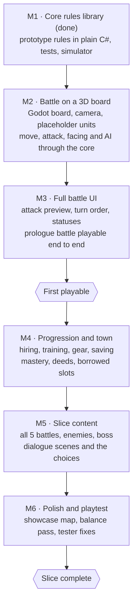

# Undercurrent: Vertical Slice Plan

darkcrux · moved from the claude.ai doc on 17 Oct 2026.

The first playable version of the game: small, complete and polished enough to judge. Everything not
listed here waits.

## Goal

The slice answers four questions:

1. **Is the combat fun across several battles,** not just one? Counters, facing, Hidden and the faction
   mechanics should still feel fresh by the last fight.
2. **Does the loop work?** Battle, then town (hire, train, buy), then the next battle, with units
   growing in between.
3. **Does the story land?** The tone, the awakening, and real choices.
4. **Does HD-2D look right** in Godot, on at least one fully dressed map?

| | |
| --- | --- |
| Length | About 60 to 90 minutes of play |
| Players | darkcrux, then a handful of trusted testers |
| Platform | PC |
| Difficulty modes | Normal only; Casual and Hard come later |

## Story scope

The slice covers the **Commonwealth origin prologue** and the **shared Chapter 1**, which every player
will see.

1. **Prologue, Commonwealth origin.** A mining town at the edge of the dead lands. The main character
   works the Lode seams until a cave-in near a violet crack wakes their power. Directorate soldiers
   arrive, and the first battle is escaping them.
2. **Chapter 1 in Ashfield (shared by every origin).** A free town where the three factions' borders
   meet, on the brink of war. The main character arrives as a fugitive and hires on with a mercenary
   company. A surge of raw Current erupts, and Ordained and Commonwealth forces both move in.
3. **Three choices that lean you toward a faction.** One early, one in the middle, one at the end, each
   pulling toward a different side:
    1. **The bounty (battle 2).** Bounty hunters are after a runaway Ordained novice hiding in the rail
       yard. Hand them over (both the Ordained and the Commonwealth pay), let them escape, or recruit
       them.
    2. **The workers (battle 4).** The company is ordered to clear workers out of the surge zone by
       force. A Common Hand engineer asks you to protect them instead. The choice changes the battle
       and how the town treats you.
    3. **The breach (battle 5).** Hold it for the Commonwealth troops, let the Ordained seal it with a
       ritual, or let the Unbound reach it first. This choice sparks the war and is the strongest lean.
4. **Chapter 1 boss and the spark.** An Ordained Warder-captain at the breach, where the violet cracks
   are worst. The battle's outcome starts the war. The chapter ends by showing which faction your
   choices have pulled you toward; the slice stops there, as a cliffhanger.

Not in the slice: the Ordained and Unbound prologues, Chapters 2 to 4, defection points, endings.

## Content

**Battles and maps**

| # | Battle | Map | What it teaches |
| --- | --- | --- | --- |
| 1 | Escape the mine (prologue) | Mining town at the dead lands' edge | Moving, attacking, counters, facing |
| 2 | Bounty hunters at the rail yard | Rail yard with cars and gantries | Height and high ground, ranged units, the turret; the bounty choice |
| 3 | The burning market | Town market square, night | Area attacks, Burning, Hidden and vision cones |
| 4 | The choice: workers in the surge zone | Foundry floor | The story choice; enemies change with it |
| 5 | Chapter 1 boss | The breach at the edge of town | Channeling, statuses, a boss that resists Stun; the breach choice |

Maps: 10 × 10 to 12 × 12 tiles, 3 to 4 height levels.

**Town:** Ashfield, a free town (neutral standing), visited between battles 2 and 5. A workshop (gear
and blueprints), a mercenary guild (hiring), a trainer, a healer, and one black-market dealer.

**Your company**

| Unit | Role | Notes |
| --- | --- | --- |
| Main character | Unbound (Awakened, later Vessel) | Placeholder kit: the Awakened line with one unique passive |
| Comrade 1 | Commonwealth Engineer from the Common Hand | Joins in battle 2; the voice of the reform wing |
| Comrade 2 | Mercenary veteran | Joins in battle 1; steady front line |
| Hired units | Mercenary and Engineer recruits | 2 to 4 available in the town, with growth grades |

Deploy up to 5 units per battle.

**Classes:** the 5 starters, plus 6 advanced: Vanguard, Skirmisher, Gunner, Saboteur, Bloodcaller and
Veilwalker. About 35 abilities.

**Enemies:** Directorate soldiers in the prologue; bounty hunters, then Ordained and Commonwealth troops
in Chapter 1; the Warder-captain boss.

## Systems in and out

| System | In the slice | Later |
| --- | --- | --- |
| Combat (turns, counters, facing, statuses, Hidden and vision) | Full, as in combat-rules.md | Balancing passes |
| Faction mechanics (channeling, deployables, Blood Price) | All three | More abilities using them |
| Attack preview and turn order | Full | — |
| Enemy AI | Prototype AI, improved (tile danger) | Smarter AI, boss behaviors |
| Perma-death | Normal mode: 3-turn countdown, revive by Restore Life or a rare item | Casual and Hard modes |
| Classes | 5 starters + 6 advanced, mastery, borrowed slots | Remaining advanced, all experts, unique classes |
| Unlock conditions | Mastery and deeds for the 6 advanced classes | The rest |
| Training and switching | In town, with the party rule | Rival-town contacts |
| Recruiting | Guild with growth grades | Faction recruiters |
| Towns and standing | One neutral town, one black-market dealer | Rival and hostile towns, standing changes |
| Items and gear | Weapons, armor, a few consumables and one revive item | Full gear and crafting |
| Story | Dialogue scenes with portraits, three leaning choices | Full routes and endings |
| Saving | Save between battles | Mid-battle suspend |
| Settings | Volume, window mode, text speed | Key rebinding, accessibility options |

## Art and audio

Placeholders everywhere except one showcase map, which proves the HD-2D look (see Art direction in
concept.md).

| Asset | Slice approach |
| --- | --- |
| Maps 1 to 4 | Built in-engine from 3D blocks with procedural textures, basic lighting |
| Map 5 (the breach) | Fully dressed showcase: final-quality tiles, fog, depth of field, glow, violet cracks |
| Character sprites | Placeholders for all units; commission final sprites for the main character and the two comrades at M4 |
| Portraits | Placeholders, or the same three commissioned |
| Effects and UI | Built in-engine: shaders, particles, the iron-and-brass interface |
| Music | Licensed or royalty-free: one battle theme, one town theme, one boss theme |
| Sound effects | Royalty-free packs |

## Milestones

Alongside the build: story work (main cast outline at M1, prologue script at M2, Chapter 1 outline at M3,
Chapter 1 script at M4, dialogue in game at M5) and art (sprite size test at M1, placeholders at M2,
effects and UI style at M3, commission 3 characters at M4, music and sound at M5, dress the showcase map
at M6). Dates stay open until the timeline is set.

## Done when

- [ ] A new player finishes all 5 battles without help, in 60 to 90 minutes.
- [ ] Testers can explain why a counter happened, and say they used the attack preview to decide.
- [ ] Facing, Hidden and high ground each decided at least one tester's move.
- [ ] At least one tester replays battle 4 to see the other side of the choice.
- [ ] Testers return to the town between battles because they want to, not because they must.
- [ ] The showcase map gets a "that looks good" before anyone is told it's the showcase.
- [ ] No crashes, no lost saves, and the game runs smoothly on a mid-range PC.

## Decisions (17 Oct 2026)

| Question | Decision |
| --- | --- |
| Origin for the slice | Commonwealth |
| Main character's unique class | Placeholder for the slice; the real class is designed after it |
| Map size | 10 × 10 to 12 × 12 tiles, 3 to 4 height levels |
| Commissioning the 3 story characters | Yes, at M4, once camera and sprite scale are set in-engine |
| Music | Licensed or royalty-free for the slice; a composer later |

## Open questions

- [ ] Names and personalities for the main character and the two comrades
- [ ] Timeline and weekly hours available
